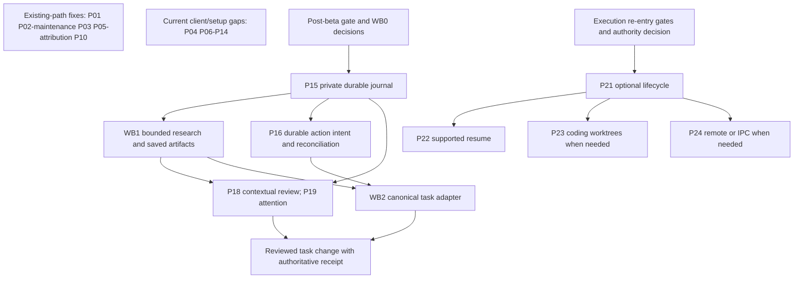

# Herdr-inspired work plan

**Status:** Proposed delivery sequence; planning requested 2026-11-08. No implementation started by this change.
**Owner:** Imperium maintainers; Adam selects product/core-contract changes and is the merge gate.
**Companions:** [development design and R01-R60 sources](herdr-development.md) · [executable TODO and acceptance](herdr-todo.md).

## Recommendation and estimate basis

Start with the reproduced event-cursor defect, honest readiness, draft/focus continuity, stop attribution and missing Windows rollback cases. These small existing-path changes do not depend on installing Herdr or building Workbench. Reuse the already planned post-beta Chat V2 foundation, then deliver one complete research-to-saved-report-to-reviewed-task flow. Optional execution, resume and remote machines follow only demonstrated need and their existing gates.

The large inventory is a portfolio of candidates, not a commitment to implement every pattern. First subtract existing behavior and tests. Keep one bounded selected slice per branch; park the rest. This protects solo-maintainer time and makes local control more dependable rather than expanding authority for its own sake.

Estimates below are engineering judgments from source review, not measured delivery times, deadlines or elapsed-calendar promises. They assume one experienced implementer with agent assistance and include focused tests/docs. Integration review, native test access, product decisions and external-service work can extend elapsed time.

| Duration requested | Working estimate for a bounded package | What it means |
| --- | --- | --- |
| Short (קצר) | About 0.5-2 focused engineering days | One existing seam, a narrow change and meaningful checks. |
| Medium (בינוני) | About 3-5 focused engineering days | A few coupled changes across UI/backend/client or native recovery cases. |
| Long (ארוך) | More than 5 focused engineering days; re-estimate after design | New persistence/authority/recovery contract or a complete multi-surface path; split before scheduling. |

Ranges such as Short-to-Medium mark unknown coverage, not extra precision. Do not sum row maxima into a project completion date: packages overlap, many are optional, and external gaps remain unmeasured.

Urgency: **U0** current demonstrated/source-inspected reliability defect; **U1** beta/recovery/client benefit; **U2** selected Workbench direction; **U3** later optional execution. These are development-order labels, not a fresh Pass/Fail audit of beta gates. Value is qualitative relative to GOALS and the selected complete journey; it is not a measured ROI score. Simplicity is listed separately: a high-value feature can still be complex.

## Package order, effort, simplicity, urgency and value

All packages are candidates or gated candidates; approval and checked status live in the TODO. Dependencies describe correctness requirements, not an obligation to wait for an unrelated whole package.

| Package | Duration | Simplicity | Urgency / value | Why it is worth doing; dependency |
| --- | --- | --- | --- | --- |
| [P01](herdr-todo.md#p01) Correct setup event cursors and resync | Short fix; Medium full resync | Moderate | U0 / Very high | Prevents later setup progress disappearing after retention rollover; a reproduced defect with a small fix surface. Dependency: None. |
| [P02](herdr-todo.md#p02) Preserve chat continuity and consume existing streaming | Medium | Moderate | U0 / Very high | Stops loss of user work and waiting without visible progress in the daily chat path. Dependency: Existing gateway streaming; no Workbench storage dependency. |
| [P03](herdr-todo.md#p03) Make readiness fresh and reject obsolete results | Medium | Moderate | U0 / Very high | Prevents stale or weak evidence declaring a client usable; restores trust in ready/status labels. Dependency: Existing readiness and connection evidence. |
| [P04](herdr-todo.md#p04) Bound retries and deadlines independently per target | Medium | Moderate | U1 / High | Keeps a failed target from disrupting healthy ones and avoids useless retry storms or unbounded waits. Dependency: A demonstrated current reconnect/setup path; P03 generation helper may be shared. |
| [P05](herdr-todo.md#p05) Explain stops and distinguish disconnect from stopped | Short attribution; Medium cancellation reconciliation | Moderate | U0 / Very high | Makes interruptions attributable and prevents false stopped/success claims; attribution does not require a GPU arbiter. Dependency: Existing lifecycle ownership and request IDs. |
| [P06](herdr-todo.md#p06) Preserve valid configuration and personal customizations | Medium | Moderate | U1 / High | Protects personal configuration and recoverability during reloads and template updates. Dependency: Inventory existing reload and persistence behavior. |
| [P07](herdr-todo.md#p07) Protect user-owned configuration publication | Short to Medium | Moderate | U1 / High | Prevents damaging a user-owned configuration file; a concrete safety finding outranks cosmetic work. Dependency: Existing configuration writer and native Windows fixtures. |
| [P08](herdr-todo.md#p08) Install scoped client hooks safely | Medium for the first client | Moderate | U1 / High | Makes the first selected client integration repeatable without duplicate hooks, Hebrew corruption or identity mix-ups. Dependency: Selected client and verified current official hook contract; P07 where config is written. |
| [P09](herdr-todo.md#p09) Version supported-client compatibility evidence | Medium for the first client | Moderate | U1 / Very high | Directly supports the G2 client-compatibility outcome and catches breakage beyond current-version-only tests. Dependency: Supported-client and installed/stable-version inventory. |
| [P10](herdr-todo.md#p10) Exercise the actual Windows installer recovery path | Medium | Moderate | U1 / Very high | Preserves the ability to recover a working installation even when replacement and rollback both fail. Dependency: Existing Windows cleanroom harness and disposable fixture directories. |
| [P11](herdr-todo.md#p11) Verify staged updates and interrupted-update recovery | Long until lifecycle gaps are bounded | Complex | U1 / High | Reduces update-related downtime and false ready receipts; scope may shrink if current lifecycle already covers it. Dependency: Packaged updater trust/lifecycle review; P10 fixture machinery is reusable. |
| [P12](herdr-todo.md#p12) Make existing actions discoverable and strictly targeted | Medium; Short unknown-argument slice | Moderate | U1 / High | Reduces action hunting and prevents typo-driven wrong-target effects without a new frontend framework. Dependency: Current action inventory; no plugin framework. |
| [P13](herdr-todo.md#p13) Expose inspectable content-free diagnostics | Short to Medium | Simple to Moderate | U1 / High | Lets the operator inspect what leaves the private content boundary; builds on existing safe diagnostics. Dependency: Existing diagnostics and telemetry allowlist. |
| [P14](herdr-todo.md#p14) Track selected-source provenance and notice freshness | Short for the first selected units | Simple | U1 when copying / High | Makes narrow code reuse legally traceable and maintainable without absorbing an upstream dependency stack. Dependency: Selected copied/adapted units; independent of unrelated fixes. |
| [P15](herdr-todo.md#p15) Add the private durable Workbench journal and artifacts | Long | Complex | U2 / Very high | Enables reopen/restart continuity and honestly saved artifacts; the foundation of a durable work journey. Dependency: WB0 approved boundary/storage contract and post-beta entry gate. |
| [P16](herdr-todo.md#p16) Make edits and uncertain mutations recoverable | Long for complete action semantics | Complex | U2 / Very high | Prevents lost edits and duplicate external effects after timeout/crash; frontend confirmation alone cannot provide this. Dependency: P15 durable intents/receipts; canonical-service contract agreed in WB0; integrate with WB2 for canonical application. |
| [P17](herdr-todo.md#p17) Bound streaming and keep execution responsive | Medium to Long after selecting the path | Complex | U2 / High | Keeps the selected research/event path bounded and responsive when a reader or producer stalls. Dependency: Representative producer/consumer path; P15 when used for durable work. |
| [P18](herdr-todo.md#p18) Build central chat with contextual artifact review | Long for a complete saved flow | Moderate to Complex | U2 / Very high | Turns a conversation into inspectable saved work without navigation/context loss; highest visible Workbench value. Dependency: P02 stable chat; P15 saved artifacts; WB1 for real research outputs. |
| [P19](herdr-todo.md#p19) Show an authoritative attention board | Medium to Long | Moderate | U2 / High | Surfaces actual decisions and unseen results so the operator need not monitor every activity continuously. Dependency: P15 authoritative run/event records; P18 integration is useful. |
| [P20](herdr-todo.md#p20) Measure repeatable UI and Workbench workloads | Short to Medium | Moderate | U2 / Medium | Detects measurable UI regressions and avoids optimizing from render counters or impressions alone. Dependency: A representative runnable UI seam; baseline may precede major UI work. |
| [P21](herdr-todo.md#p21) Define optional execution lifecycle and observed status | Long | Complex | U3 / Conditional high | Adds value only when visible parallel execution is genuinely needed; avoids hiding worker/process authority. Dependency: WB0 execution decision plus every future-orchestration re-entry gate. |
| [P22](herdr-todo.md#p22) Resume one supported client safely | Medium to Long for the first client | Complex | U3 / Medium | Reduces lost session setup for a supported client; valuable only after lifecycle and identity are dependable. Dependency: P21 verified lifecycle and session identity. |
| [P23](herdr-todo.md#p23) Isolate coding activities in explicit worktrees | Medium | Moderate | U3 / Medium | Protects canonical/concurrent code work when a selected executor actually needs to edit a repository. Dependency: P21 selected coding executor and explicit workspace mutation authority. |
| [P24](herdr-todo.md#p24) Make remote execution and local control explicit | Long | Complex | U3 / Medium | Makes remote location and disclosure explicit; worth its complexity only with a concrete remote/IPC use case. Dependency: P21 and a demonstrated remote/local-IPC need. |

## Phases and measurable exit points

| Phase | Packages | Main value / exit point | Entry gate |
| --- | --- | --- | --- |
| A - trust existing daily operation | P01; maintenance slices of P02, P03, P05; P10 | Retention rollover loses no later events; draft/focus survive refresh; stale checks cannot declare ready; stops have safe causes; injected install failures preserve recovery. | Isolated source ownership, current gap reproduction; no Herdr installation/Workbench prerequisite. |
| B - dependable client/setup/release evidence | P04, P06-P09, P11-P14 | One declared client can be set up/rechecked safely, compatibility is evidenced and packaged recovery is exercised. Existing behavior is extended, not duplicated. | Gap review; official selected-client contract; P14 only blocks actual borrowing. |
| C - one durable private research journey | WB0, P15, WB1, P17-P20, remaining P02 Chat V2 slice | Ask in Hebrew, follow a bounded run, inspect/reopen a source-linked saved report after reload; partial/interrupted states stay honest. | Existing post-beta Chat V2 gate; explicit WB0 boundary/product decisions; no general worker scheduler. |
| D - reviewed canonical task effect | P16, WB2, P18/P19 integration | Review exact change; apply once through the canonical service; timeout/crash reconciles receipt; board shows confirmed outcome. | Phase C durable artifacts/intents; owning service's atomic receipt/precondition contract; no substitute local task database. |
| E - optional visible execution | P21-P24 | One visible/stoppable bounded worker, optional resume/workspace/remote additions and verified gateway use. | Every future-orchestration re-entry gate plus selected authority/need; core starts without adapter. |

Phases A/B can contain independent packages; their numbering is not a requirement to serialize everything. Phase C layout design and a mocked shell can proceed against agreed interfaces, but do not claim a durable flow before P15/WB1. Phase D read-only preview can precede mutation support, but Apply remains unavailable until WB2/P16 receipts are proven. Phase E is outside the beta-fix critical path.

## Workbench prerequisites not supplied by the Herdr inventory

These are necessary to complete the already-selected product journey. They are explicit companion work, not additional Herdr-source discoveries or existing modules. They prevent a polished panel from being mistaken for a functioning research/task system.

| ID | Deliverable | Duration / simplicity | Urgency / value | Dependencies and acceptance |
| --- | --- | --- | --- | --- |
| WB0 | Reconcile Workbench boundary, contracts and retention with GOALS/ADRs/Chat V2 | Medium / Complex decision work | U2 / Very high | No implementation prerequisite. Before P15, decide private roots/records, network/disclosure scope, retention/clear/export, run/cancel/replay/action contracts, limits and canonical ownership; record required ADR(s) as Proposed until approved. |
| WB1 | One bounded source-backed research pipeline and artifact evidence | Long / Complex | U2 / Very high | WB0 and P15; use existing gateway/admission and model tiers. Support selected local/text sources first; explicit public-web mode later as selected. Bound work, distinguish search hits from read sources, preserve partial outputs, check citations and measure chosen quality/latency/privacy thresholds. |
| WB2 | Canonical task-service projection/apply/reconciliation adapter | Long / Complex; owning-service effort unmeasured | U2 / Very high | WB0, P15/P16 and source-linked artifact from WB1. The canonical service must supply atomic dedupe, revision preconditions, operation receipt and outcome lookup. Prove concurrency/crash/timeout behavior in both owners; do not infer safety from frontend approval alone. |

Calendar/email providers, recurring automations, arbitrary shell/filesystem tools, browser control, full workflow editors and marketplaces are not hidden dependencies of this first flow. They require later selected scope and authority.

## Dependency map and parallel work

P17 load/stream bounds and P20 comparable workload checks apply to the chosen Phase C path; they are not prerequisites for a small setup counter fix. P14 runs before importing actual source, not before independent reliability work. P07/P09 can start independently; P08 uses their safeguards/contracts where needed. Mocked UI and backend record design can proceed in parallel after WB0 interfaces, with separate files and one integration owner.

The first complete Workbench critical path is **WB0 → P15 → WB1 → P18 → P16/WB2 → confirmed task receipt**, with attention, load bounds and UI checks integrated alongside it. WB2's external service contract is the largest unmeasured dependency. Design and read-only review can continue if it is unavailable; task writes remain blocked. Neither P21-P24 nor Herdr installation belongs on this path.

## What is genuinely simple, and what should wait

- Smallest high-value start: P01's independent counter and retention-boundary regression. Full snapshot/resync can be a follow-up slice.
- Other small slices: P05 first-cause attribution; P12 reject unknown target arguments; P13 report inspection over the existing allowlist; P14 narrow provenance for selected units.
- Moderate rather than trivial: draft/caret preservation through current full rerenders, honest readiness and one native client hook. Each crosses real state or platform boundaries.
- Long: durable restart/replay, immutable artifacts, ambiguous-effect reconciliation, packaged update recovery and Windows session resume. A green label or saved layout cannot replace outcome evidence.
- Defer native terminal rendering, broad plugin authority, remote machines and general worker dispatch until an actual selected use case and re-entry gates justify them.

Optional discovery **T01**: after separately authorized Herdr App installation, run three bounded sessions on a disposable project: one real client task, two parallel activities/attention checks, and close/reopen during work. Keep at most three observed product lessons. Disable optional usage telemetry, avoid third-party mods, and verify gateway routing separately. This is Short discovery work, not an installation instruction or prerequisite for existing defects. Stop if setup/customization consumes the trial or the extra UI increases load.

## Handoff and change control

Documentation review branch: `ready/herdr-development-plan`; owner Codex; source baseline `c0f1865f90388265c04d226dd5ee52106ee8beee`. Adam authorized committing the scoped documentation, pushing the branch and opening a GitHub pull request on 2026-11-08. The pull request records the published head and checks. Publication does not select implementation packages, authorize installation/runtime changes or approve merging. The active checkout's local changes are excluded.

At package selection, record approver, exact source/client baseline, changed seams, dependency decisions, checks and unresolved risks in the TODO. Check boxes only with linked implementation and verification evidence; keep code-ready, CI, packaged/runtime and live-client results separate. Re-estimate after gap review, and split any Long package into reviewable deliveries before scheduling. Follow [Git workflow](development/git-workflow.md) and [release governance](../RELEASE.md).
